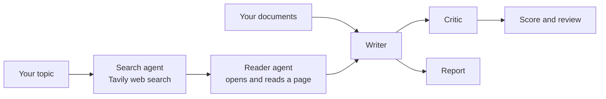

# ResearchMind

Ask a question and four AI agents take it from there: one searches the web, one reads the best page, one writes a sourced report, and one scores it and says what is missing.

<table>
  <tr>
    <td></td>
    <td></td>
  </tr>
</table>


[](https://github.com/YOUR_USERNAME/researchmind/actions/workflows/ci.yml)

## What it does

- **Four agents in order.** Search agent, reader agent, writer and critic, with live progress for each step.
- **A report and a review.** The writer drafts an Introduction, Key Findings, Conclusion and Sources. The critic gives a score out of 10, strengths and areas to improve.
- **Your own documents.** Upload PDF, Word, text, Markdown or CSV files and the writer uses them alongside the web research. Or skip the web and use only your documents.
- **Control over the output.** Choose the report style (standard, executive brief, deep dive), the audience, and the language (English, Urdu, Arabic, Spanish, French, German, Hindi).
- **Control over the research.** Basic or advanced search, 3 to 10 results per search, and up to three pages for the reader agent to open first.
- **Download** the report as Markdown, and open the Sources tab for every link the agents found.
- **Light and dark mode** with a button in the top bar.
- **Any OpenAI-compatible model.** Works with OpenAI, or with providers such as Groq by setting a base URL.

## How it works



The search and reader agents are LangChain agents with one tool each. The writer and critic are prompt chains. Each step's output is passed to the next.

## Quick start

You need Python 3.10 or newer, a model API key, and a free [Tavily](https://tavily.com) key for search.

```bash
git clone https://github.com/muneerahmedkhokhar53-wq/Multi-Agent-AI-Research-Assistant.git
cd Multi-Agent-AI-Research-Assistant

python -m venv .venv
source .venv/bin/activate        # Windows: .venv\Scripts\activate
python -m pip install -r requirements.txt

cp .env.example .env             # Windows: copy .env.example .env
# open .env and add your keys

streamlit run app.py
```

The app opens at http://localhost:8501.

## Configuration

Settings live in a `.env` file next to `app.py`. Never commit this file; it is already in `.gitignore`.

| Variable | Required | What it does |
| --- | --- | --- |
| `LLM_API_KEY` | yes (or `OPENAI_API_KEY`) | API key for the model provider |
| `LLM_BASE_URL` | no | Base URL for an OpenAI-compatible provider, for example `https://api.groq.com/openai/v1` |
| `LLM_MODEL` | no | Model name. Defaults to `gpt-4o-mini` |
| `TAVILY_API_KEY` | yes | Key for web search |

`.env.example` is set up for Groq's free tier. For OpenAI, delete the three `LLM_` lines and set `OPENAI_API_KEY` instead.

The app sets `SEARCH_MAX_RESULTS` and `SEARCH_DEPTH` itself from the options in the form. They only matter if you run the command-line version.

## Using it

**In the browser:** type a topic, press **Start research**, and watch the pipeline. Open **Add documents and options** to upload files or change the style, audience, language and search settings. When it finishes, the **Report**, **Review** and **Sources** tabs hold the results.

**From the terminal:**

```bash
python pipeline.py
```

This runs the same four steps and prints each result to the console.

## Project layout

```
app.py          Streamlit app: layout, form, running the pipeline
ui.py           Theme (light and dark), CSS and HTML builders
agents.py       Model setup, search and reader agents, writer and critic chains
tools.py        The two agent tools: web search (Tavily) and page scraping
options.py      How the form options change the prompts
documents.py    Turns uploaded files into text
pipeline.py     Command-line version of the pipeline
tests/          Unit tests for ui.py, options.py and documents.py
```

`ui.py`, `options.py` and `documents.py` do not import Streamlit or LangChain, so they can be tested on their own.

## Development

```bash
python -m unittest discover -s tests -t . -v
```

The same command runs in CI on Python 3.10, 3.11 and 3.12. See [CONTRIBUTING.md](CONTRIBUTING.md) before opening a pull request.

## Limitations

Research outputs are machine-generated and may contain omissions or incorrect interpretations. Verify important claims against the linked source material before using the report for academic, professional, or high-stakes decisions. Search and page-reading coverage depends on external services and page accessibility.

- The reader agent keeps the first 3,000 characters of a page, and each search snippet is cut to 300 characters. Long pages are only partly read.
- Scanned PDFs have no text layer and are rejected with a message. Run OCR on them first.
- Free model plans limit how much text they accept per minute. If a run fails on a rate limit, lower **Characters read from documents** or wait a minute.
- The report is only as good as the sources found. Check the Sources tab and the critic's review before relying on it.

## Troubleshooting

**"The research agents couldn't start"** The app could not find your keys. Check that `.env` is in the same folder as `app.py` and contains `LLM_API_KEY` (or `OPENAI_API_KEY`) and `TAVILY_API_KEY`, then reload.

**A step stops with an error** Read the details under the pipeline. The usual causes are a wrong key, no network connection, or a rate limit.

## Contributing

Issues and pull requests are welcome. See [CONTRIBUTING.md](CONTRIBUTING.md).

## License

[MIT](LICENSE)
